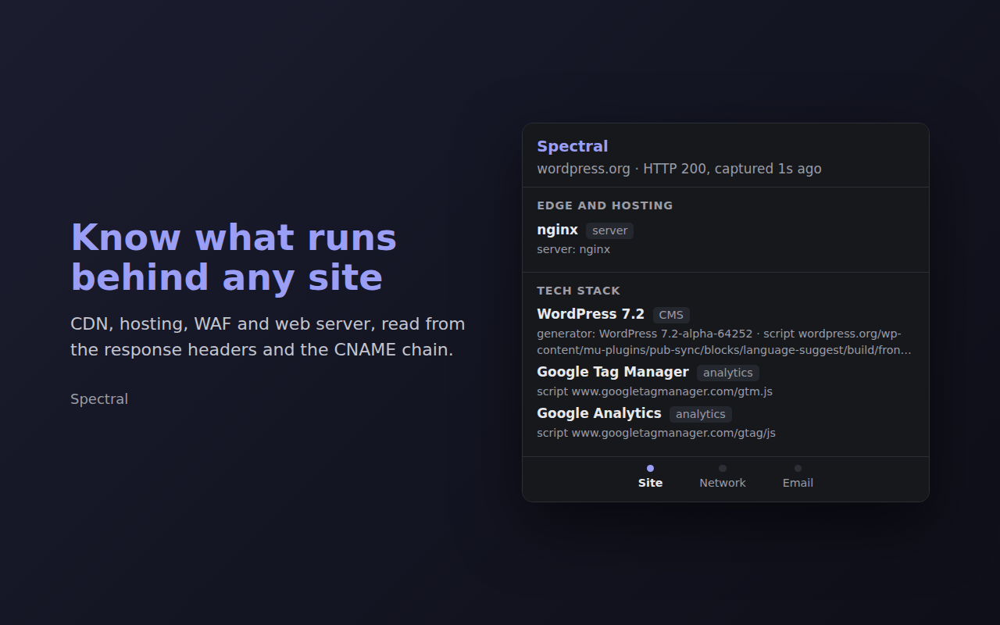
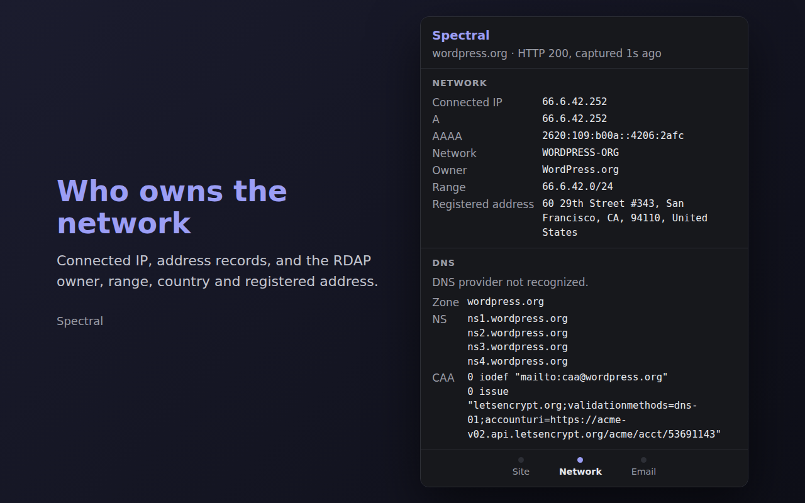
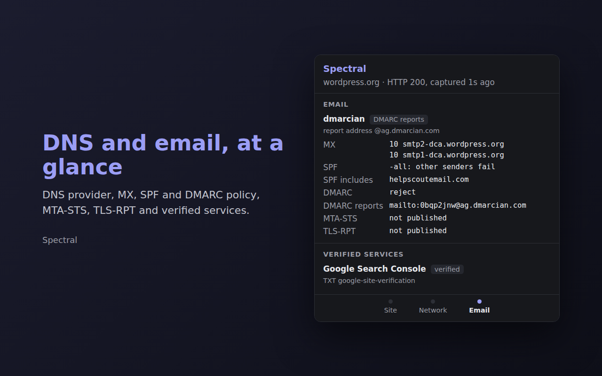

<p align="center">
  
</p>

<h1 align="center">Spectral</h1>

<p align="center">
  See what runs behind any website: CDN, hosting, tech stack, network owner,
  DNS and email setup, with the evidence for each.
</p>

<p align="center">
  <a href="https://github.com/danielededo/spectral/actions/workflows/ci.yml"></a>
  <a href="https://github.com/danielededo/spectral/releases/latest"></a>
  <a href="https://microsoftedge.microsoft.com/addons/detail/spectral/ljoalgbbmkfgcihfgeanhkocoklokbll"></a>
  <a href="LICENSE"></a>
</p>

<p align="center">
  <a href="https://microsoftedge.microsoft.com/addons/detail/spectral/ljoalgbbmkfgcihfgeanhkocoklokbll">Get it for Edge</a> ·
  <a href="#installation">Other browsers</a> ·
  <a href="https://spectral.danielededo.it/privacy">Privacy policy</a> ·
  <a href="CHANGELOG.md">Changelog</a> ·
  <a href="https://github.com/danielededo/spectral/issues">Report a problem</a>
</p>

<p align="center">
  
  
  
</p>

A browser extension that shows what runs behind the site in your current tab:
the CDN and hosting in front of it, the frameworks and libraries it is built
with, who owns the IP network, which provider serves its DNS and email, and
which SaaS the domain has verified ownership with. Each finding comes with the
header, DNS record or page element that proves it.

Status: early development. Available on
[Microsoft Edge Add-ons](https://microsoftedge.microsoft.com/addons/detail/spectral/ljoalgbbmkfgcihfgeanhkocoklokbll); not yet on the
Chrome Web Store or Firefox Add-ons.

## Features

The panel groups findings into six sections over three pages, Site, Network
and Email, reached by swiping, by the labelled dots at the bottom, or with the
left and right arrow keys:

- Edge and hosting: CDN, hosting platform, WAF and web server, from response
  headers and the CNAME chain.
- Tech stack: CMS, frameworks, JavaScript libraries, UI kits and fonts,
  analytics, commerce, consent and other third-party services, with versions
  when the page exposes them. It reads the generator meta tag, script and
  stylesheet URLs, a fixed list of well-known globals and DOM markers, and the
  captured response headers.
- Network: connected IP, A and AAAA records, and the RDAP network name, owner,
  range, country and the owner's registered address (where the network is
  registered, not where the server physically is).
- DNS: zone apex, DNS provider recognized from the nameservers, NS and CAA
  records.
- Email: inbound provider from MX records and outbound senders from SPF
  includes; what the SPF policy does with other senders; the DMARC policy,
  its coverage and alignment, where reports go and which service collects
  them; whether MTA-STS and TLS-RPT are published.
- Verified services: SaaS inferred from domain verification TXT records.

## Installation

Edge: install from [Microsoft Edge Add-ons](https://microsoftedge.microsoft.com/addons/detail/spectral/ljoalgbbmkfgcihfgeanhkocoklokbll).
Updates arrive automatically.

For other browsers, each [release](https://github.com/danielededo/spectral/releases/latest)
carries two packages: `spectral-<version>-chromium.zip` for Chrome and Edge,
and `spectral-<version>-firefox.zip` for Firefox. Extract the Chromium one and
load the folder as described below; Firefox loads the zip directly as a
temporary add-on.

To build from source instead:

```
npm ci
npm run build
```

The build writes `dist/` for Chromium browsers and Safari, and
`dist-firefox/` for Firefox; they differ only in `manifest.json`.

Chrome and Edge: open `chrome://extensions` (or `edge://extensions`), enable
Developer mode, choose Load unpacked and select `dist/` (or the extracted
release folder).

Firefox (140 or later): open `about:debugging#/runtime/this-firefox`, choose
Load Temporary Add-on and select `dist-firefox/manifest.json` (or the release zip), or run
`npm run firefox:run`. Firefox treats host permissions as optional, so grant
"Access your data for all websites" from the extension's permissions page.

Firefox for Android (142 or later): enable USB debugging on the phone and
remote debugging in Firefox settings, connect it, find its id with
`adb devices`, then run `npm run firefox:android -- --android-device=<id>`.
The popup opens full width from the Extensions entry of the browser menu.

Chrome for Android and the other iOS browsers have no extension support.

Safari on iPhone (experimental): the `Safari iOS` workflow converts the build
into a Safari Web Extension inside a small iOS app and compiles it without a
signature, on a GitHub-hosted Mac. Run it from the Actions tab, download the
`spectral-ios-unsigned` artifact, then sign and install the `.ipa` from
Windows or macOS with Sideloadly and a free Apple ID. On the iPhone, enable
Developer Mode (Settings, Privacy and Security), trust the developer profile
(Settings, General, VPN and Device Management), and turn the extension on in
Settings, Apps, Safari, Extensions. A free Apple ID signature expires after
seven days. Whether Safari exposes response headers to extensions is not yet
verified, so the header-based findings may be missing there.

`npm run firefox:lint` validates the Firefox build against Mozilla's add-on
rules and is expected to report no warnings.

Response headers are captured while a page loads, so reload tabs that were
already open before the extension was installed.

## Privacy

Spectral has no backend and sends no telemetry. When you open the popup it
makes these requests, and only these:

| Service | Receives | Purpose |
| --- | --- | --- |
| `cloudflare-dns.com` | the site's hostname and zone apex | DNS-over-HTTPS lookups of A, AAAA, SOA, NS, MX, TXT and CAA, plus TXT at `_dmarc`, `_mta-sts` and `_smtp._tls` under the apex |
| `rdap.org` and the regional registry it redirects to | one IP address of the site | network owner lookup |

Captured response headers stay in the browser's session storage, one entry
per tab, deleted when the tab closes or the browser quits. The tech stack is
read from the open page when the popup opens and analyzed in the popup; none
of it is stored or sent anywhere.

Because the hostname of the inspected site leaves the browser, the Firefox
manifest declares the `browsingActivity` data collection category, which
Firefox shows to the user at install time.

The full policy is published at <https://spectral.danielededo.it/privacy>. It
is served from the `site` repository (`src/data/spectralPrivacy.ts`), so change
it there whenever the table above changes.

## Development

```
npm run check      # typecheck and unit tests
npm run dev        # rebuild dist/ and dist-firefox/ on change
npm run test:e2e   # load dist/ in Chromium and drive the popup (build first)
npm run icons      # regenerate public/icons/ from scripts/icon.svg
```

The end-to-end tests need Playwright's Chromium, installed once with
`npx playwright install chromium`, or an existing binary passed through the
`CHROMIUM_PATH` environment variable. They serve a local fixture site and
mock the DoH and RDAP responses, so they run offline.

Fingerprints live in `src/infrastructure/detect.ts` and
`src/techstack/detect.ts` as pure rules with unit
tests; see [AGENTS.md](AGENTS.md) for the architecture and conventions, and
[CONTRIBUTING.md](CONTRIBUTING.md) for the workflow.

More documents:

- [docs/STORE-LISTING.md](docs/STORE-LISTING.md): store texts, permission
  justifications, images and the release steps.
- [docs/adr/](docs/adr/README.md): architecture decisions, such as why there
  is no backend.
- [SECURITY.md](SECURITY.md): how to report a vulnerability privately.
- [CHANGELOG.md](CHANGELOG.md): what changed in each version.

## Structure

```
/
├── README.md                       # this file
├── AGENTS.md                       # AI agent instructions (single source of truth)
├── CLAUDE.md                       # pointer to AGENTS.md
├── CONTRIBUTING.md                 # contribution workflow
├── CODE_OF_CONDUCT.md              # Contributor Covenant
├── SECURITY.md                     # how to report vulnerabilities
├── CHANGELOG.md                    # Keep a Changelog + SemVer
├── LICENSE                         # MIT
├── package.json                    # scripts and dev dependencies
├── tsconfig.json
├── vite.config.ts                  # popup build settings
├── playwright.config.ts            # end-to-end test runner
├── public/
│   └── icons/                      # generated PNGs, 16 to 128 px
├── scripts/
│   ├── build.ts                    # builds dist/ (Chromium) and dist-firefox/: popup, then background
│   ├── manifest.ts                 # writes each build's manifest.json from src/manifest.json
│   ├── manifest.test.ts
│   ├── icon.svg                    # icon source
│   └── render-icons.ts             # renders icon.svg into public/icons/
├── e2e/
│   ├── fixtures.ts                 # extension context, fixture site, lookup mocks
│   ├── infrastructure.e2e.ts
│   ├── techstack.e2e.ts
│   └── tsconfig.json
├── src/
│   ├── manifest.json               # Manifest V3 source; the build adds the background key per browser
│   ├── background.ts               # service worker: captures main_frame responses
│   ├── shared/
│   │   └── capture.ts              # per-tab capture in storage.session
│   ├── infrastructure/
│   │   ├── detect.ts               # fingerprint rules and parsers (pure)
│   │   ├── detect.test.ts
│   │   ├── mail.ts                 # SPF, DMARC, MTA-STS and TLS-RPT parsing (pure)
│   │   ├── mail.test.ts
│   │   └── lookup.ts               # DNS-over-HTTPS and RDAP clients
│   ├── techstack/
│   │   ├── probe.ts                # runs in the page, collects raw markers
│   │   ├── detect.ts               # technology rules, snapshot validation (pure)
│   │   └── detect.test.ts
│   └── popup/
│       ├── index.html
│       ├── main.ts                 # renders the panel
│       ├── pager.ts                # page strip: tabs, arrow keys, swipe
│       └── style.css
├── docs/
│   ├── STORE-LISTING.md            # store texts, permission justifications, images, release steps
│   ├── BRANCHING-STRATEGY.md       # trunk-based/GitHub Flow vs release-based
│   ├── COMMIT-CONVENTION.md        # Conventional Commits, with examples
│   ├── AI-AGENTS.md                # guidelines for CLAUDE.md / AGENTS.md
│   └── adr/
│       ├── README.md               # what ADRs are and the index
│       ├── 0000-template.md
│       ├── 0001-trunk-based-development.md
│       └── 0002-client-only-extension.md
└── .github/
    ├── PULL_REQUEST_TEMPLATE.md
    ├── ISSUE_TEMPLATE/
    │   ├── bug_report.md
    │   ├── feature_request.md
    │   └── config.yml
    ├── dependabot.yml              # npm and GitHub Actions updates
    └── workflows/
        ├── ci.yml                  # check, build, Firefox lint and end-to-end tests
        ├── release.yml             # on a v* tag: Chromium and Firefox zips attached to a GitHub Release
        └── safari.yml              # on demand: unsigned iOS app with the Safari extension
```

## License

Distributed under the MIT License; see [LICENSE](LICENSE).
